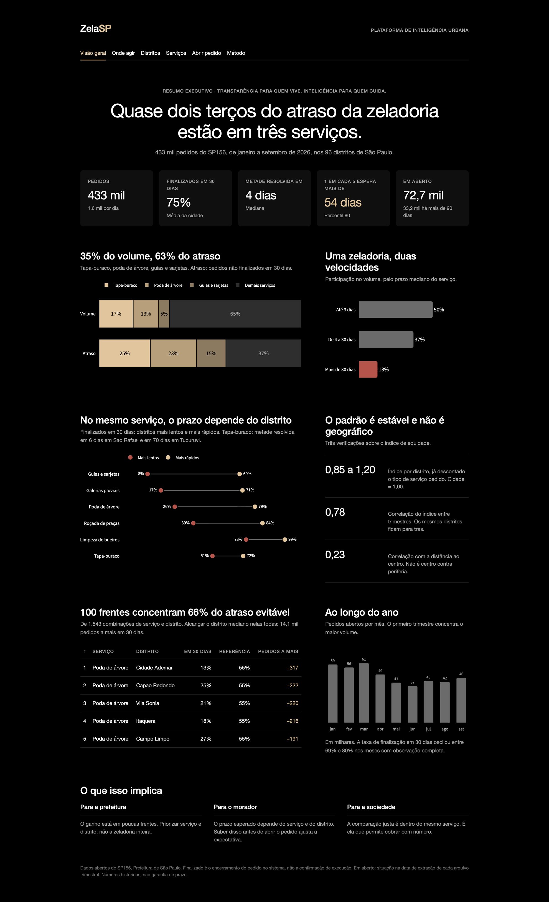
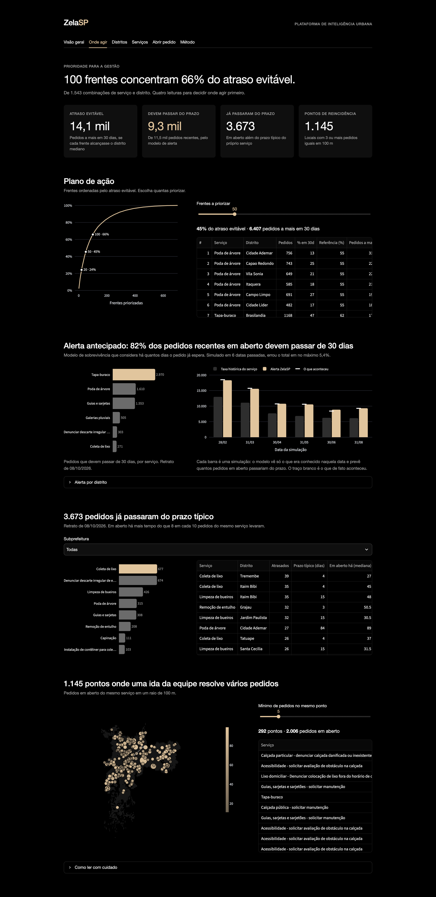
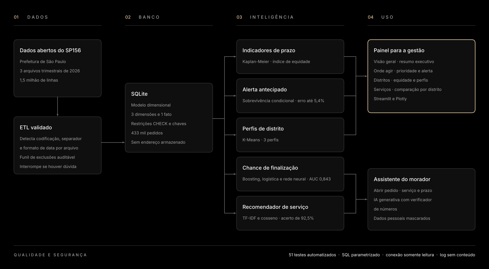

# FIAP - Faculdade de Informática e Administração Paulista

# ZelaSP

**Plataforma de inteligência urbana**

*Transparência para quem vive. Inteligência para quem cuida.*

**QUERO CONCORRER**

Global Solution 2026.2 · CitizenTech · Fase 7 · Graduação em Inteligência Artificial

## Grupo 67

## 👨‍🎓 Integrantes:
- Jocasta de Kacia Bortolacci · RM564730
- Pedro Henrique do Nascimento Souza · RM565326

## 👩‍🏫 Professores:

### Tutor(a)
- Nicolly Cândida Rodrigues de Souza

### Coordenador(a)
- <a href="https://www.linkedin.com/in/andregodoichiovato/">André Godoi Chiovato</a>

## 📜 Descrição



Uma cidade melhor começa com uma gestão mais inteligente.

O ZelaSP transforma dados públicos em informação acessível para cidadãos e inteligência estratégica para gestores, identificando desigualdades no atendimento e indicando onde a cidade precisa de mais atenção.

A pergunta de partida: o mesmo pedido de zeladoria leva o mesmo tempo em qualquer distrito de São Paulo? Com os dados abertos do SP156, o ZelaSP responde e entrega duas coisas.

**Para a prefeitura e as subprefeituras:** onde agir primeiro. Quais combinações de serviço e distrito concentram o atraso, quais pedidos já passaram do prazo típico do próprio serviço e em quais pontos vários moradores pedem a mesma coisa.

**Para o morador:** o nome correto do serviço a partir de uma descrição em linguagem comum e o prazo que pedidos iguais levaram no distrito dele.



Foram analisadas 433.077 demandas de zeladoria abertas entre janeiro e setembro de 2026 nos 96 distritos da cidade.

### Principais resultados

| Resultado | Evidência |
|---|---|
| A desigualdade de prazo existe | Índice de equidade padronizado pelo mix de serviços vai de 0,85 a 1,20 entre distritos |
| Ela é estável | Spearman de 0,63 a 0,78 entre trimestres |
| Ela se concentra em poucos serviços | Poda de árvore: 26% finalizados em 30 dias no distrito do percentil 10, 79% no do percentil 90. Entulho: 96% e 99% |
| Ela não segue a lógica centro e periferia | Spearman de 0,23 entre índice e distância ao centro, no sentido contrário ao esperado |
| O atraso evitável é concentrado | 100 das 1.543 combinações de serviço e distrito respondem por 66% dele |
| É possível prever quais pedidos vão passar do prazo | Alerta por sobrevivência condicional: em 6 simulações em datas passadas, o total previsto ficou a no máximo 5,4% do real (a taxa histórica do serviço erra 30% para menos) |
| O distrito acrescenta pouco, mas acrescenta, à previsão | AUC 0,820 sem distrito e 0,843 com distrito, em validação temporal |

A hipótese inicial era de que a periferia seria atendida mais lentamente. Os dados não sustentaram a hipótese, e o projeto reporta isso como resultado. As ressalvas dessa leitura estão no PDF, seção 3.3.

### Arquitetura



### Integração entre disciplinas

| Conteúdo | Aplicação no projeto |
|---|---|
| Python e engenharia de software | Pacote modular, exceções próprias, logging, scripts reproduzíveis |
| Tratamento e análise de dados | ETL com detecção e validação de formato por arquivo, funil de qualidade auditável |
| Banco de dados e SQL | Modelo dimensional em SQLite, restrições CHECK, chaves estrangeiras, visão, 5 consultas analíticas |
| Estatística | Kaplan-Meier para demandas em aberto, padronização indireta, Spearman |
| Machine Learning não supervisionado | K-Means com escolha de k por silhueta |
| Machine Learning supervisionado | Regressão logística e gradient boosting com validação temporal e baseline |
| Redes neurais | MLP comparada aos demais modelos |
| Análise de sobrevivência preditiva | Alerta antecipado de pedidos que devem passar de 30 dias, validado por simulação em datas passadas |
| Recomendação e PLN | TF-IDF de palavras e caracteres, similaridade de cosseno, léxico curado |
| IA generativa | Redação da orientação restrita a uma ficha de fatos, com verificador de números |
| Cibersegurança e LGPD | Minimização de dados, mascaramento de CPF, telefone e e-mail, SQL parametrizado, conexão somente leitura, log sem conteúdo |
| Visualização interativa | Streamlit e Plotly |

## 📁 Estrutura de pastas

```
├── app.py                    painel Streamlit (ponto de entrada)
├── requirements.txt          dependências
├── .streamlit/config.toml    tema do painel
├── assets/
│   ├── figuras/              gráficos gerados por scripts/02_analise.py e 04_diagrama.py
│   └── telas/                capturas do painel em execução
├── config/
│   └── entrega.json          integrantes, turma e links usados no PDF
├── data/
│   ├── raw/                  CSVs do portal (não versionados, ver "Como executar")
│   └── processed/            zeladoria.db, modelo_prazo.joblib, resumo.json
├── docs/
│   ├── GS2_ZelaSP.pdf        documento da entrega
│   └── evidencias_pytest.txt saída da suíte de testes
├── scripts/                  executados nesta ordem
│   ├── 01_etl.py             leitura, validação, limpeza e carga no banco
│   ├── 02_analise.py         indicadores, alerta, K-Means, modelos e figuras
│   ├── 03_pdf.py             gera o PDF da entrega
│   ├── 04_diagrama.py        gera o diagrama de arquitetura
│   └── 05_conformidade.py    confere a entrega contra as regras do enunciado
├── sql/
│   ├── schema.sql            modelo do banco
│   └── consultas.sql         consultas analíticas de referência
├── src/zeladoria/            pacote com a lógica, sem dependência do painel
│   ├── config.py             parâmetros e recorte de zeladoria
│   ├── etl.py                leitura e tratamento
│   ├── db.py                 carga e acesso ao banco
│   ├── indicadores.py        Kaplan-Meier, índice de equidade, prioridade e alerta
│   ├── clusters.py           K-Means
│   ├── modelo.py             classificadores e avaliação
│   ├── recomendador.py       recomendação de serviço por texto
│   └── assistente.py         orientação ao morador e travas da IA generativa
└── tests/                    51 testes automatizados e consultas simuladas
```

## Como executar

Requer Python 3.11 ou superior.

```bash
python -m venv .venv
source .venv/bin/activate        # Windows: .venv\Scripts\activate
pip install -r requirements.txt
```

### Opção 1: abrir o painel com o banco já processado

O banco `data/processed/zeladoria.db` está versionado.

```bash
streamlit run app.py
```

### Opção 2: reproduzir tudo a partir dos dados brutos

1. Baixe em https://dados.prefeitura.sp.gov.br/dataset/dados-do-sp156 os arquivos CSV `Dados do SP156 - 1º TRI 2026`, `2º TRI 2026` e `3º TRI 2026`.
2. Salve os três em `data/raw/`.
3. Rode:

```bash
python scripts/01_etl.py        # cerca de 20 segundos
python scripts/02_analise.py    # cerca de 30 segundos
python scripts/03_pdf.py
streamlit run app.py
```

### Testes

```bash
python -m pytest tests -v
```

### IA generativa (opcional)

Sem chave de API, a orientação ao morador usa redação determinística. Para ativar a redação por IA generativa, defina as variáveis de ambiente antes de abrir o painel. Qualquer provedor com API compatível com a da OpenAI funciona.

```bash
export LLM_API_KEY="sua-chave"
export LLM_MODEL="gpt-4o-mini"          # opcional
export LLM_BASE_URL="https://..."       # opcional, para outro provedor
```

O painel informa, abaixo de cada orientação, se o texto veio da IA generativa ou da redação padrão, e o motivo.

## Limitações

- Finalizada é encerramento administrativo, não confirmação de execução.
- A base só contém o que foi registrado.
- A data de corte de cada arquivo é inferida, porque o portal não informa a data de extração.
- Não há identificador de protocolo: linhas idênticas foram tratadas como uma demanda.
- O índice aponta onde o prazo difere, não a causa.
- O recomendador foi avaliado com 40 consultas simuladas, escritas pela equipe.
- Nomes de distrito aparecem sem acento, como na fonte.
- Sem implantação em nuvem e sem validação com usuários.

## Fonte dos dados

Prefeitura de São Paulo, Secretaria Municipal de Inovação e Tecnologia. Dados do SP156 - Solicitações. Portal de Dados Abertos. Arquivos do 1º, 2º e 3º trimestres de 2026, baixados em 18/11/2026.

## 📎 Links e Observações

### 🔗 Links do Projeto

* **Vídeo de entrega no YouTube (não listado):** https://youtu.be/ML5adW8WR-0
* **Repositório:** https://github.com/jojocamdb/gs2fiap
* **PDF da entrega:** [docs/GS2_ZelaSP.pdf](docs/GS2_ZelaSP.pdf)
* **Fonte dos dados:** [Dados do SP156 - Solicitações](https://dados.prefeitura.sp.gov.br/dataset/dados-do-sp156), Portal de Dados Abertos da Prefeitura de São Paulo

### 🧠 Decisões Técnicas

| Decisão | Justificativa |
|---|---|
| SQLite em vez de Oracle | Arquivo único: o avaliador roda o projeto sem instalar servidor. O esquema usa SQL padrão, com restrições CHECK e chaves estrangeiras, e migra com ajuste de tipos |
| Kaplan-Meier em vez de média de prazo | 17% dos pedidos estavam em aberto na data de corte. A média das finalizadas subestimaria o prazo |
| Índice padronizado pelo mix de serviços | Distritos pedem serviços diferentes. Taxa bruta mistura desempenho com tipo de pedido |
| Validação temporal dos modelos | Pedidos do mesmo lote de execução são correlacionados. Divisão aleatória inflaria as métricas |
| Recuperação por TF-IDF em vez de classificador supervisionado | A base aberta não traz o texto digitado pelo morador, então não há rótulo para treinar |
| IA generativa restrita a uma ficha de fatos | A resposta é descartada se citar número que não foi calculado pelo sistema |
| Mapa de desenho próprio | Sem dependência de servidor externo de mapas, o painel roda em qualquer rede |
| Sem endereço no banco | Minimização de dados: a análise é por distrito e a coordenada é arredondada a cerca de 100 m |
| Streamlit | Painel interativo em Python, a linguagem do curso, sem camada de front-end separada |

### 📢 Observações Gerais

* **Participação na Competição:** [x] Sim, aceitamos participar / [ ] Não vamos participar.
* A chamada a um provedor real de IA generativa não foi validada até a entrega. Sem chave de API, o painel usa redação determinística, que é o caminho testado.

## Histórico de lançamentos

- 1.0.0 · 19/11/2026 · entrega da Global Solution 2026.2
